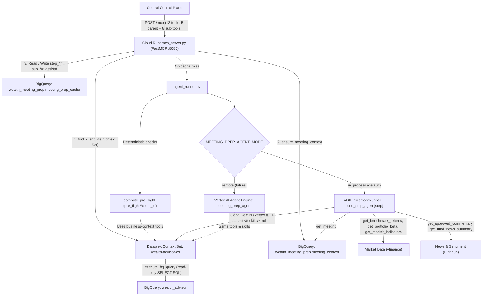

# Wealth Advisor — GCP Meeting Prep MCP Server (`agents_meeting_prep`)

This repository contains the GCP implementation of the **Meeting Prep MCP Server**, designed for **Cloud Run** deployment and **Control Plane** integration.

---

## 1. Architecture & Design Highlights

1. **Knowledge Catalog / Context Set First (`wealth-advisor-cs`)**:
   - All business data queries (clients, holdings, valuations, IPS, goals, CRM interactions, open risk alerts) discover table schemas, JOIN paths, and threshold rules dynamically through the **Dataplex Context Set (`wealth-advisor-cs`)** (`list_catalog_nodes`, `lookup_schema`, `lookup_context`, `lookup_catalog_rule` -> `execute_bq_query` against `wealth_advisor`), preserving graph-like relationship discovery.
2. **In-Process ADK Execution by Default + Future-Ready Remote Agent Engine**:
   - **`MEETING_PREP_AGENT_MODE=in_process` (default)**: Runs step-scoped Google ADK `LlmAgent` instances (`GlobalGemini` `gemini-3.8-flash`) directly inside the Cloud Run container via `InMemoryRunner`, loading only `master_meeting_prep.md` + the active step's skill files. This avoids remote Agent Engine HTTP/session-creation latency.
   - **`MEETING_PREP_AGENT_MODE=remote` (future toggle)**: `agent.py` exports `root_agent` and includes `.agent_engine_config.json` + `scripts/deploy_meeting_prep_agent.py` so the agent can be deployed to **Vertex AI Agent Engine** anytime with zero code changes.
3. **Operational State & Bidirectional Caching (`wealth_meeting_prep`)**:
   - `wealth_meeting_prep.meeting_context` and `wealth_meeting_prep.meeting_prep_cache` sit **outside** the Dataplex Context Set and are accessed through dedicated operational helpers.
   - Parent tools cache full step outputs (`pre_flight#`, `step_snapshot#`, `step_risks#`, `step_angles#`, `step_activity#`, `assist#`). Sub-tools slice directly from warm parent caches with `0` LLM calls, or compute and cache `sub_*#` entries on cold runs.
4. **Business-Context Naming + Backward Compatibility**:
   - Internal tools and step runners use business-context names (`find_client`, `get_client_profile`, `get_holdings`, `get_valuations`, `get_ips`, `get_prior_plan`, `get_crm_interactions`, `get_portfolio_alerts`, `get_meeting`, `get_benchmark_returns`, `get_approved_commentary`, `run_portfolio_snapshot`, `run_risks_and_opportunities`, `run_discussion_angles`, `run_recent_activity`, `assemble_meeting_brief`), while keeping legacy aliases so existing `skills/*.md` prompts continue working unchanged.

---

## 2. End-to-End Workflow



**Request Flow:**
1. Control Plane sends `POST /mcp` (stateless Streamable HTTP) to `mcp_server.py` on Cloud Run.
2. `mcp_server.py` resolves the client (by ID or name) via `find_client()` (Context Set -> `wealth_advisor.client`) and ensures a row exists in `wealth_meeting_prep.meeting_context`.
3. `mcp_server.py` checks `wealth_meeting_prep.meeting_prep_cache`:
   - **Cache hit**: Returns cached JSON (or slices the sub-tool result from a warm parent cache) immediately.
   - **Cache miss**: Runs `compute_pre_flight` (for risk/angle steps) and invokes `agent_runner.py` (`InMemoryRunner` with only that step's skills), saves the result in `meeting_prep_cache`, and returns the Agent Design Guide JSON envelope (`ok | partial | needs_input | error`).

---

## 3. MCP Tools Exposed (`POST /mcp`)

### Parent Tools (5)
| Tool Name | Purpose |
| :--- | :--- |
| `get_portfolio_snapshot` | Holdings, total portfolio value, cost basis, unrealized G/L, YTD/1Y returns, and per-fund trends. |
| `get_risks_and_opportunities` | Runs all 5 specialist insight sub-skills + deterministic pre-compute checks to produce normalized signals and risk metrics. |
| `get_discussion_angles` | Applies `advisory_reasoning_map.yaml` to validated signals to produce ranked discussion angles and next best actions. |
| `get_recent_activity` | Retrieves and frames the client's last 6 CRM interactions and prior decisions. |
| `get_meeting_brief` | End-to-end orchestrator (`orchestrator.py`) reusing all cached steps, running `BriefAssembler` + PPTX export, and caching `assist#`. |

### Granular Sub-Tools (8)
| Sub-Tool Name | Parent Step | Description |
| :--- | :--- | :--- |
| `get_holding_trends` | `get_portfolio_snapshot` | Per-fund trend labels (`Growing`, `Stable`, `Decelerating`, `Declining`) and remarks comparing YTD vs. 2024 returns. |
| `get_portfolio_performance_insights` | `get_risks_and_opportunities` | Holding-level and portfolio-level performance changes and benchmark gaps. |
| `get_allocation_drift_and_policy_insights` | `get_risks_and_opportunities` | Asset-class allocation vs. IPS targets/ranges (warnings and breaches). |
| `get_concentration_risk_insights` | `get_risks_and_opportunities` | Single-fund, issuer, and sector concentration vs. IPS limits. |
| `get_liquidity_and_goal_insights` | `get_risks_and_opportunities` | Excess cash vs. net worth, liquidity needs, goal funding gaps, retirement horizon, and behavioral alerts. |
| `get_market_and_investment_insights` | `get_risks_and_opportunities` | Broad market indicators (`VIX`, `SPY`, `QQQ`) and market review triggers. |
| `get_next_best_actions` | `get_discussion_angles` | Prioritized advisor preparation tasks and follow-ups (`nextBestActions[]`) without full discussion-angle framing. |
| `get_fund_news` | `get_meeting_brief` | Concise live news and return summaries for significant holdings (>5% portfolio weight). |

---

## 4. Repository Structure

```text
wa_gcp/
  Dockerfile
  .dockerignore
  .gitignore
  README.md
  agents_meeting_prep/
    __init__.py
    .agent_engine_config.json    # Config for optional future Vertex AI Agent Engine deploy
    tools.py                     # Context Set + BigQuery tools, business-context wrappers, pre_compute, BQ context/cache
    market_tools.py              # Self-contained yfinance & Finnhub tools
    agent.py                     # build_step_agent(step) + root_agent (ADK LlmAgent)
    agent_runner.py              # InMemoryRunner (default) + remote Agent Engine toggle
    orchestrator.py              # Step-level BigQuery caching + PPTX export
    mcp_server.py                # FastMCP stateless HTTP server (:8080, 13 tools)
    pptx_utils.py                # PowerPoint brief generator
    requirements.txt
    test_gcp_mcp.py              # Offline pytest verification suite (6/6 passing)
    skills/                      # Domain skill .md and .yaml files
  scripts/
    deploy_meeting_prep_agent.py # Optional script for future Vertex AI Agent Engine deployment
```

---

## 5. Deployment & Testing

### Offline Verification
```bash
pytest agents_meeting_prep/test_gcp_mcp.py -v
```

### Deploy to Cloud Run (from GCP Cloud Shell)
Ensure `run.googleapis.com`, `artifactregistry.googleapis.com`, and `cloudbuild.googleapis.com` are enabled and the deploying user has Cloud Run / Artifact Registry / Cloud Build / Service Account User permissions:

```bash
git clone https://github.com/Vishnuhari22/wealth-advisor-gcp.git
cd wealth-advisor-gcp
gcloud config set project agentic-wealthadvisor

gcloud run deploy meeting-prep-mcp \
  --source . \
  --region us-west1 \
  --service-account wealthadvisor@agentic-wealthadvisor.iam.gserviceaccount.com \
  --set-env-vars GCP_PROJECT_ID=agentic-wealthadvisor,GCP_LOCATION=us-west1,BQ_DATASET=wealth_advisor,BQ_MP_DATASET=wealth_meeting_prep,BQ_LOG_DATASET=wealth_logs_and_cache,CONTEXT_SET_ID=wealth-advisor-cs-v1,MEETING_PREP_AGENT_MODE=in_process,FINNHUB_API_KEY=<your_finnhub_key> \
  --timeout 300 \
  --memory 2Gi \
  --allow-unauthenticated
```

### Live Testing via MCP Inspector
```bash
npx @modelcontextprotocol/inspector
```
Connect using **Streamable HTTP** -> `https://<your-cloud-run-url>/mcp` and test `tools/list` (13 tools) and sample calls for `Nathan Kerrigan` (`C022`). *(Set Control Plane MCP client timeout to `120–180s` for cold `get_meeting_brief` calls.)*
